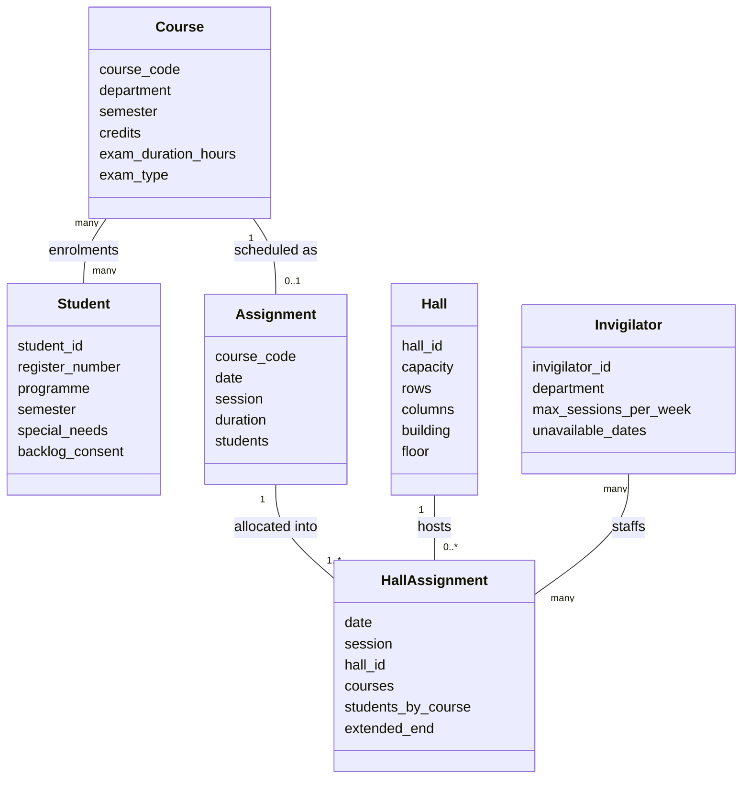
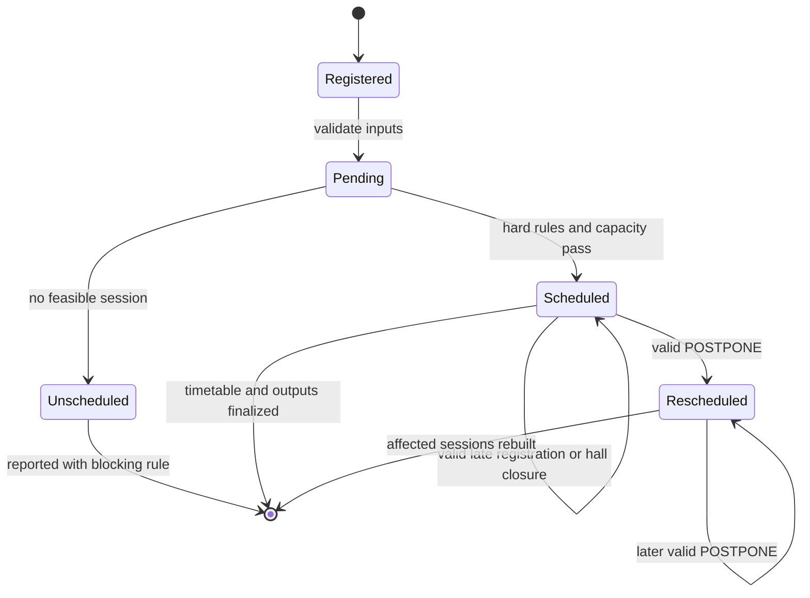

# PS-067 Design Document

## Glossary

| Term | Meaning |
|---|---|
| Course | A course code, department, semester, credits, duration, and enrolment set. |
| Exam assignment | One course's date and FN/AN session in the timetable. |
| Session | FN (09:30) or AN (14:00) on a calendar date. |
| Hall assignment | One or more compatible courses allocated to a hall for one session. |
| Backlog exam | A supplementary exam constrained to the final three calendar days. |
| Core course | A course with at least four credits. |
| Soft violation | A gap-rule exception used only when no gap-compliant session is feasible. |
| Unstaffed | A required invigilator or chief could not be assigned without breaking eligibility. |

## Domain model

The CSV masters are loaded into normalized lookup maps by `DataLoader`.
`Assignment` and `HallAssignment` are the runtime scheduling and allocation
records; report classes serialize those records without owning business rules.

## Exam lifecycle

## Business-rule register

| ID | Rule and implemented outcome |
|---|---|
| BR-01 | A student cannot have two exams in one session or more than one exam per day, except two different-session exams when the student has backlog consent and one exam is backlog. The third same-day exam is rejected. |
| BR-02 | Core courses (credits >= 4) in the same programme-semester cohort require at least one complete calendar day between exams. Cohorts are derived from enrolled students' programme/semester, with course department/semester as a fallback. Holidays count as calendar days. Electives have no gap. A gap-only fallback is recorded as a soft violation. |
| BR-03 | Courses are ordered by enrolment descending, credits descending, and course code. Each is placed in the earliest feasible session, preferring a gap-compliant placement. A bounded deterministic repair pass displaces only blocking assignments to recover unscheduled courses; backlog courses remain restricted to their permitted final sessions. |
| BR-04 | Total enrolment in a session may not exceed 90% of available hall capacity. The integer threshold is rounded down. Two- and three-hour exams cannot share a hall. |
| BR-05 | Halls are considered largest first. Each holds at most two courses; courses must be from different departments; courses with fewer than 10 students must share. Exactly 10 students may use a hall alone. |
| BR-06 | Seats are row-major; students are sorted by register number within course queues and placed in alternating columns to avoid adjacent same-course seats. Special-needs students require row 1 of a ground-floor hall; unseated students receive an explicit status. Special-needs priority takes precedence over the general queue order. |
| BR-07 | Each hall requires `ceil(students / 30)` invigilators, minimum one, plus one chief per building/session. Hall invigilators cannot invigilate their own department's course. All staff are limited to two sessions/day and their weekly maximum; unavailable dates/periods and special-needs extensions are respected. |
| BR-08 | Eligible invigilators are ordered by assigned load, department, then ID. A chief is reserved before hall staffing and attached to a compatible hall in the building. Unavailable dates/periods are respected. Exhaustion produces an explicit `UNSTAFFED` roster row and violation. |
| BR-09 | A postponed course moves to the earliest later feasible session. Its old and new sessions alone are rebuilt; other session assignments are retained. Student daily/backlog constraints are rechecked. |
| BR-10 | A closed hall is excluded from that session. If the remaining halls cannot fit the session, the smallest movable course is placed in a later feasible session and a warning is recorded. |
| BR-11 | A late registrant is rejected if the addition creates a clash. Otherwise, a compatible hall with the most free seats is selected; rejected additions are rolled back. |
| BR-12 | Backlog exams are limited to AN in the final three calendar days. Enrolment above 50 also permits FN in those days. |

## Validation and known acceptance limits

Input validation covers unique identifiers, enrolment references and
duplicates, valid durations/credits/flags, hall capacity versus dimensions,
window slots/times/holidays, late-enrolment references, invigilator limits,
and optional unavailability periods.

The official sample pack can be placed locally under `data/official`; its
command format and output columns are documented in its README. The pack is
excluded from Git because it contains student identifiers and special-needs/
consent flags. Its README states that expected output files are not included.
Running the pack therefore verifies input compatibility and the exposed rule
scenarios, but does not establish field-for-field equivalence with the hidden
evaluation set.
